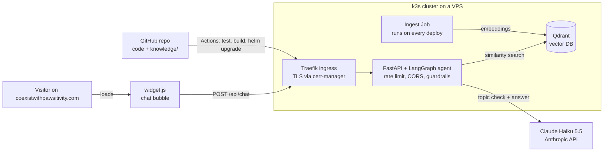

# Blueprint: Pawsitivity RAG Agent

A chat assistant for **coexistwithpawsitivity.com** that answers visitor questions **only** from content you provide,
politely refuses unrelated questions, and runs on your own small Kubernetes cluster.

The starter code in this repository already implements everything in sections 2 to 5.
Sections 6 to 9 are the steps you take to get it live.

---

## 1. Goals

| Goal | How it is met |
|---|---|
| Answers come from your content only | RAG over the `knowledge/` folder, the answer prompt allows only retrieved context, `NO_ANSWER` fallback |
| Unrelated questions are refused | 5 guardrail layers (section 4) |
| Reachable from the website | One `<script>` tag loads a chat bubble; API on `chat.coexistwithpawsitivity.com` |
| Cheap to run | Claude Haiku 5.5, local embeddings, one small VPS |
| Good portfolio project | LangChain/LangGraph, Qdrant, Docker, Kubernetes (k3s), Helm, GitHub Actions CI/CD, evals |

**Not in scope for v1:** user accounts, storing chat histories, admin UI for uploads, streaming answers (see roadmap).

---

## 2. Architecture



* **The website does not change**, apart from one script tag. Its hosting stays as it is.
* **The assistant lives on a subdomain** (`chat.coexistwithpawsitivity.com`) that points at the VPS.
* **The API is stateless:** the widget sends the last few turns with every message. Nothing is stored server-side, so scaling to more replicas is trivial and there is no chat log to protect.

---

## 3. Tech stack and why

| Layer | Choice | Why |
|---|---|---|
| LLM | **Claude Haiku 5.5** (`claude-haiku-5-5`) via `langchain-anthropic` | Fast and very cheap; one call for the topic check, one for the answer |
| Orchestration | **LangGraph** (LangChain) | Explicit state machine: every guardrail is a node, every route is testable |
| Embeddings | `paraphrase-multilingual-MiniLM-L12-v2` via **fastembed** (ONNX, CPU) | German + English, runs inside the container, no second API key, baked into the image |
| Vector DB | **Qdrant** (official Helm chart) | Production-grade, easy to run in k8s, supports hybrid search later |
| API | **FastAPI** + slowapi | Validation, CORS, per-IP rate limits |
| Frontend | Vanilla JS widget in Shadow DOM | Works on any website builder, no CSS clashes, no build step |
| Packaging | Docker (multi-stage, non-root) | Same image for API and ingestion |
| Runtime | **k3s** on one VPS + **Helm** chart | Real Kubernetes for a few euros a month; Traefik ingress included |
| TLS | **cert-manager** + Let's Encrypt | Automatic HTTPS for the subdomain |
| CI/CD | **GitHub Actions** → GHCR → `helm upgrade` | Push to `main` = tested, built and deployed |
| Quality | pytest (no API key needed) + **eval set** against the real model | Guardrails stay correct as content and prompts change |

---

## 4. Request flow and guardrails

```
visitor message
  │
  ├─ 1. input_check (no LLM)  empty / too long / blocked terms / prompt-injection patterns ──► "blocked"
  │
  ├─ 2. topic_check (Haiku)   IN_SCOPE | SMALLTALK | OUT_OF_SCOPE, unclear output = OUT_OF_SCOPE ──► "refused" / greeting
  │
  ├─ condense                 follow-up questions are rewritten into a standalone search query
  │
  ├─ 3. relevance threshold   no chunk with cosine similarity ≥ MIN_RELEVANCE ──► "no_answer" (no generation at all)
  │
  ├─ 4. grounded answer       prompt allows CONTEXT only, model must reply NO_ANSWER if it is not there
  │
  └─ 5. output_check          blocks answers that leak the system prompt ──► "blocked"
```

Plus, around the graph:

* **Rate limiting:** 20 messages per minute per IP (`RATE_LIMIT`)
* **CORS:** only your domain may call the API from a browser
* **Size limits:** 800 characters per message, 6 turns of history
* **Safe rendering:** the widget renders answers with `textContent`, never HTML
* **Privacy:** visitor messages are never logged, only status, latency and the number of retrieved chunks
* **Network policy:** only the API pods may reach Qdrant
* **Spend limit:** set a monthly limit in the Anthropic Console as the last safety net

**All texts and patterns are in `config/guardrails.yaml`.** The most important field is `scope_description`. Write it precisely, because the topic check is only as good as that description.

**Tuning `MIN_RELEVANCE`:** start at 0.35. Run the eval set. If on-topic questions end up as `no_answer`, lower it. If unrelated questions get through, raise it.

---

## 5. Knowledge base

* **Source of truth is the `knowledge/` folder,** versioned in Git: `.md`, `.txt`, `.pdf`, `.html`, plus optional `urls.txt` to pull public pages from your website.
* **Front matter** (`title`, `url`) gives every answer a clickable source link.
* **Best format:** short files per topic, FAQs as `## Question` + answer. The splitter cuts at headings first (900 characters, 150 overlap).
* **Ingestion** (`scripts/ingest.py`) rebuilds the collection from scratch, so deleted content disappears too. In production it runs as a Helm post-upgrade Job. Changing content means commit → push → CI → new image → re-index.

**What to write first:** about / mission, the team, services or offers, events, FAQ (10–20 real visitor questions), contact and opening details, and policies you want quoted exactly.

---

## 6. Phase plan

| Phase | Result | Time |
|---|---|---|
| **0. Content** | 5–10 Markdown files in `knowledge/`, `scope_description` written, eval cases with real questions | 1 evening |
| **1. Local** | `make up && make ingest`; chat on http://localhost:8080; `make eval` ≥ 90 % | 1 evening |
| **2. Local Kubernetes** | Same app via Helm on `kind` (`make kind-up helm-local`) | 1 evening |
| **3. Production** | VPS with k3s, cert-manager, DNS, `helm install`; widget live on the website | 1 day |
| **4. CI/CD** | Push to `main` tests, builds and deploys automatically | 2 hours |
| **5. Improve** | Roadmap items (section 10) driven by eval results | ongoing |

### Phase 1: run locally

The `.env` file is already created for you in the project folder. Files starting with a dot are hidden in Finder;
press **Cmd + Shift + .** to show them, or open it from the Terminal with `open -e .env`.
Replace `sk-ant-...` with your Anthropic API key and save.

All commands below run in the Terminal **inside the project folder**:

```bash
cd ~/Documents/pawsitivity-rag-agent
open -e .env                    # paste your ANTHROPIC_API_KEY, save
# put your content into knowledge/  (see knowledge/README.md)
make up                         # API :8000, Qdrant :6333, demo page :8080
make ingest                     # index knowledge/
open http://localhost:8080      # chat bubble bottom right
make install && make test       # unit tests (no API key needed)
make eval                       # eval set against Claude
```

**If something fails:** `docker compose logs api --tail 50` shows the error. The chat itself shows a friendly
"not available" message instead of an error page. After changing code, rebuild with `docker compose up --build -d`.
Content changes in `knowledge/` only need `make ingest`.

### Phase 2: practise the Kubernetes deployment locally

**Setup** (once): Docker Desktop must be running. Then:

```bash
brew install kind kubectl helm
cd ~/Documents/pawsitivity-rag-agent
make kind-up          # creates the local cluster "pawsitivity" (a Kubernetes node inside Docker)
make helm-local       # builds the image, loads it into kind, stores the API key from .env as a Secret, helm install
```

`make helm-local` waits until the API is ready and the ingest job has finished, which takes 2 to 5 minutes the first time.
Run it again after every code or content change.

**Verify automatically:**

```bash
make verify-local
```

The script checks everything below and ends with `Result: N passed, 0 failed`.
To test with a question from your own content, run `QUESTION="..." make verify-local`.

| # | Check | What "good" looks like | Manual command |
|---|---|---|---|
| 1 | Release installed | `STATUS: deployed` | `helm status pawsitivity-rag -n pawsitivity` |
| 2 | Pods running | API and Qdrant `1/1 Running`; ingest pod `Completed` | `kubectl -n pawsitivity get pods` |
| 3 | Content indexed | Ingest log shows `N chunks from M sources` with your files; collection count > 0 | `kubectl -n pawsitivity logs job/pawsitivity-rag-ingest` |
| 4 | In-cluster test | `helm test` passes (health endpoint + widget reachable via the Service) | `helm test pawsitivity-rag -n pawsitivity` |
| 5 | API reachable | `{"ok":true}` | `kubectl -n pawsitivity port-forward svc/pawsitivity-rag 8001:8000` then `curl localhost:8001/healthz` |
| 6 | Guardrails with the real model | content question → `answered` with sources; coding → `refused`; injection → `blocked`; "Hi" → `smalltalk` | see `scripts/verify_k8s.sh` |
| 7 | CORS | `http://localhost:8080` allowed, foreign origins rejected | |
| 8 | Self-healing | a deleted API pod is replaced and ready again | `kubectl -n pawsitivity delete pod -l app.kubernetes.io/component=api` |

**Verify in the browser:**

```bash
make down          # stop docker compose first, it also uses port 8000
make open-local    # port-forward to the cluster + demo page
```

Open http://localhost:8080 and chat. The answers now come from the Kubernetes deployment.

**Optional: run the eval set inside the cluster**

```bash
kubectl -n pawsitivity exec deploy/pawsitivity-rag -- python -m scripts.run_evals
```

**If something fails:**

| Symptom | Look at |
|---|---|
| Pod `Pending` | `kubectl -n pawsitivity describe pod <name>`: usually not enough memory. Give Docker Desktop at least 6 GB. |
| `ErrImageNeverPull` | The image was not loaded into kind. Run `make helm-local` again. |
| `CrashLoopBackOff` | `kubectl -n pawsitivity logs deploy/pawsitivity-rag --previous` |
| Ingest job failing | `kubectl -n pawsitivity logs job/pawsitivity-rag-ingest`. Qdrant may still be starting; the job retries by itself. |
| Chat answers "not available" | `kubectl -n pawsitivity logs deploy/pawsitivity-rag \| grep failed`: wrong API key or no API credit |

**Clean up:** `make kind-down` deletes the whole cluster.

### Phase 3: production

Everything runs from the project folder on your Mac. Replace `IP` with your server's IP address.
Total time: about 1 to 2 hours, mostly waiting.

**What the setup looks like**

| Piece | Choice | Why |
|---|---|---|
| Server | Ubuntu 24.04, 2 vCPU, **4 GB RAM** (2 GB works in small-server mode, see 3.2). Monthly cancellable, for example **OVHcloud VPS-1** or **IONOS VPS M+** | Monthly contracts, no long commitment. Hetzner's cheap CX plans are not orderable since mid-2026; netcup has a minimum term |
| Access | SSH keys only; user `deploy` for deployments; Kubernetes API **not** open to the internet | Small attack surface |
| Firewall | Only ports 22, 80 and 443 | |
| Images | GitHub Container Registry, built by GitHub Actions | No registry to run yourself |
| Backups | None needed: the vector index is rebuilt from Git on every deploy | Keep the API key in your password manager |

#### 3.1 Put the code on GitHub and build the first image

```bash
cd ~/Documents/pawsitivity-rag-agent
git init -b main
git add .
git status                 # .env must NOT be in the list (it is in .gitignore)
git commit -m "Pawsitivity RAG agent"
gh repo create pawsitivity-rag-agent --public --source=. --push   # or create the repo on github.com and git push
```

1. **Wait for the build.** Open the repo's **Actions** tab and wait until the `test` and `image` jobs are green. The `deploy` job just says it is skipped, because no server is configured yet.
2. **Make the image public.** On GitHub, go to your profile → **Packages** → `pawsitivity-rag` → **Package settings** → **Change visibility** → **Public**. The server can then pull the image without credentials.

The image contains your `knowledge/` files. That content is public website content anyway, and the API key is never in the image.

#### 3.2 Rent the server

1. **SSH key:** if you don't have one yet, run `ls ~/.ssh/id_ed25519.pub || ssh-keygen -t ed25519`.
2. **Order the server:** a VPS with Ubuntu 24.04, 2 vCPU and at least 2 GB RAM. When the image is installed, paste the content of `~/.ssh/id_ed25519.pub` as the SSH key.
3. **Test the connection:** `ssh root@IP` must log you in without a password. Then type `exit`.

**Small-server mode (servers with less than 3 GB RAM)**

The setup and deploy scripts check the server's memory and switch on small-server mode by themselves.
You don't have to change any commands.

| | Normal (4 GB) | Small-server mode (2 GB) |
|---|---|---|
| Swap | none | 2 GB swap file as a safety buffer |
| Kubernetes extras | metrics-server on | metrics-server off, so `kubectl top` is not available |
| Indexing your content | separate ingest job after each deploy | inside the API pod at startup, so the embedding model is loaded only once (saves about 400 MB) |
| Deploys | new API pod starts before the old one stops: no downtime | old pod stops first: **about 30 to 60 seconds without chat** per deploy |
| Memory limits | API 1 GB, Qdrant 768 MB | API 900 MB, Qdrant 384 MB |

Estimated use in small-server mode is about 1.5 GB. These are estimates; measure on the server with `free -m`.

**Test small-server mode on your Mac before you rent the server:**

```bash
make helm-local SMALL=1
make verify-local
```

In the check output, step 3 says "no ingest job". That is expected in this mode. The chunk count must still be greater than 0.

#### 3.3 Point the subdomain at the server

**Find where the DNS is managed.** That is the place where you bought `coexistwithpawsitivity.com`, or the website builder if the domain came with it.

**Add one record. Leave all existing records unchanged.**

| Type | Name / Host | Value | TTL |
|---|---|---|---|
| A | `chat` | `IP` | 300 |

**Check that it works:**

```bash
dig +short chat.coexistwithpawsitivity.com    # must print IP (can take a few minutes up to a few hours)
```

#### 3.4 Set up the server (once)

```bash
make server-setup HOST=IP EMAIL=you@example.com
# OVHcloud logs you in as "ubuntu" instead of root:
make server-setup HOST=IP EMAIL=you@example.com SETUP_USER=ubuntu
```

`deploy/k3s/bootstrap.sh` runs on the server and does the following:
1. Installs updates and enables automatic security updates.
2. Sets up the firewall and turns off password login.
3. Creates the user `deploy`.
4. Installs k3s and configures Traefik to keep the visitor's real IP, which the per-visitor rate limit needs.
5. Installs Helm, cert-manager and the Let's Encrypt issuer.
6. Asks for your Anthropic API key, with hidden input, and stores it only as a Kubernetes Secret.

It takes about 5 minutes and can be run again safely.

#### 3.5 Deploy

```bash
make deploy-prod HOST=IP
```

This copies the Helm chart to the server and installs `ghcr.io/<your-github-user>/pawsitivity-rag:latest`. Helm waits until the API is ready and the ingest job has indexed your content. The first run takes about 5 minutes because the image has to be downloaded.

#### 3.6 Verify

```bash
make verify-prod HOST=IP
```

This runs two sets of checks:

* **Inside the cluster:** the same checks as in Phase 2, except deleting a pod.
* **From the internet** (`scripts/verify_public.sh`):
  * DNS resolves
  * the Let's Encrypt certificate is valid
  * `/healthz` and `/widget.js` work over HTTPS
  * CORS allows `coexistwithpawsitivity.com` and `www.coexistwithpawsitivity.com` and rejects other sites
  * one real question is answered

The certificate can take 1 to 2 minutes after the first deploy. If that check fails, wait and run `make verify-public` again.

#### 3.7 Go live

1. **Embed the widget** on the website (all pages):
   ```html
   <script src="https://chat.coexistwithpawsitivity.com/widget.js" data-color="#2f6f4f" defer></script>
   ```

   | Site builder | Where to paste it | Note |
   |---|---|---|
   | WordPress | A "header and footer scripts" plugin or the theme footer | |
   | Wix | Settings → Custom Code, body end, all pages | Needs a premium plan with a connected domain |
   | Squarespace | Settings → Code Injection → Footer | Needs a paid plan |
   | Webflow | Project settings → Custom code → Footer | |
   | Static or self-built | Paste it before `</body>` | |

2. **Test on the real website,** on desktop and on your phone: one content question, one unrelated question.
3. **Update the privacy policy** (section 7).
4. **Set a monthly spend limit** in the Anthropic Console.

#### Running it day to day

| Task | Command |
|---|---|
| Update content or code | Commit and push to `main`. With Phase 4 set up, it deploys by itself. Without it: wait for the `image` job, then `make deploy-prod HOST=IP` |
| Logs (one line per question, no message content) | `make logs-prod HOST=IP` |
| Undo the last deploy | `make rollback-prod HOST=IP` |
| Change the API key | `ssh -t root@IP 'RESET_KEY=1 bash /root/k3s/bootstrap.sh you@example.com'`, then `make deploy-prod HOST=IP` |
| Health check | `make verify-public` |
| Kernel updates | Security updates install by themselves. Run `ssh root@IP reboot` every few months; everything comes back on its own |

#### If something fails

| Symptom | Cause and fix |
|---|---|
| `ImagePullBackOff` | The GHCR package is still private. Make it public (3.1) |
| Certificate check fails for more than 10 minutes | DNS does not point to the server yet, or port 80 is blocked. Check with `ssh deploy@IP kubectl -n pawsitivity describe challenge` |
| Widget appears but answers "Sorry, something went wrong" | Open the browser console. A CORS error means the page's address (with or without `www`) is missing in `ALLOWED_ORIGINS` in `values-prod.yaml` |
| Widget does not appear at all | The script tag is not on the page, or your site builder plan does not allow custom code |
| Pods `Pending` or `OOMKilled` on a 2 GB server | Check `ssh deploy@IP 'free -m; kubectl -n pawsitivity get pods'`. If memory is really full, move to 4 GB: the same commands work there without changes |
| Everyone gets "sending messages very fast" | Visitors' IPs are not passed through. Check that `/var/lib/rancher/k3s/server/manifests/traefik-config.yaml` exists, then run `make deploy-prod` again |
| "Assistant not available" | `make logs-prod HOST=IP`: usually the API key or credit |

### Phase 4: CI/CD

`.github/workflows/ci.yml` already does the following:

* **On every push and pull request:** ruff, pytest, `helm lint`, chart rendering with the production values.
* **On `main`:** builds the image, then **deploys over SSH** as user `deploy` with the commit's image tag, then runs `make verify-public` against the live site.

To switch on automatic deployment, give GitHub its own SSH key for the server:

```bash
ssh-keygen -t ed25519 -f ~/.ssh/pawsitivity_deploy -N "" -C github-actions
ssh-copy-id -i ~/.ssh/pawsitivity_deploy.pub deploy@IP
gh secret set DEPLOY_HOST --body IP
gh secret set DEPLOY_SSH_KEY < ~/.ssh/pawsitivity_deploy
ssh-keyscan -H IP | gh secret set DEPLOY_KNOWN_HOSTS
```

Push any change to `main` and watch the four steps (test → image → deploy → smoke test) in the Actions tab.
After that, updating the assistant's knowledge means: edit a file in `knowledge/`, commit, push.

---

## 7. Data protection (GDPR)

* **Update the website's privacy policy (Datenschutzerklärung):** the chat sends visitor messages to Anthropic (USA) for processing. Name the purpose, the legal basis (legitimate interest or consent) and the processor.
* **Anthropic's commercial terms include a Data Processing Addendum.** Check which applies to your API account.
* **The server stores no chat content.** Logs contain status and latency only.
* **The widget tells visitors it is an AI** and that answers can be wrong.
* **Optional:** show the bubble only after cookie or consent acceptance, or show a short notice before the first message.

---

## 8. Cost estimate

| Item | Monthly |
|---|---|
| VPS 2 vCPU / 4 GB | about €6–12, depending on provider and plan after the 2026 price changes |
| Claude Haiku 5.5 ($0.10 / M input, $0.50 / M output tokens) | about 2,500 input + 250 output tokens per message ≈ $0.0004, so 1,000 messages ≈ $0.40 |
| Domain / DNS | already owned |

Guardrails save money too: blocked and refused messages never reach the expensive answer step.

---

## 9. Testing and monitoring

* **Unit tests (`tests/`):** guardrail patterns, every graph route, API validation, CORS, rate limiting. They use a fake LLM and fake search and run in CI without secrets.
* **Eval set (`evals/cases.yaml`):** grow it to 30+ cases from real visitor questions. Run `make eval` before changing prompts, thresholds or models. The script exits with an error below 90 %, so it can gate deploys.
* **Monitoring:**
  * `kubectl logs` shows one line per request: `status=answered|refused|no_answer|blocked`.
  * A rising `no_answer` share means missing content. A rising `refused` share for real questions means `scope_description` is too narrow.

---

## 10. Roadmap after v1

1. **Streaming answers** (SSE) for a faster feel.
2. **Hybrid search** (BM25 sparse + dense in Qdrant) and a reranker for better retrieval on names and specific terms.
3. **Zero-downtime re-index:** build into a new collection, then switch a Qdrant alias.
4. **Tracing:** self-hosted Langfuse to inspect each step and its token cost.
5. **Feedback buttons** (thumbs up/down) to collect new eval cases.
6. **Agent tools:** for example `get_upcoming_events` from a calendar or `contact_form` handover, as LangGraph tool nodes.
7. **Admin upload page** so non-technical people can update content without Git.

---

## 11. What you can put on your CV afterwards

> *Personal project: Built and deployed a RAG assistant with guardrails for a public website: LangGraph agent with Claude, Qdrant vector search, multi-layer input/output guardrails, evaluation set as quality gate; containerised with Docker and deployed via Helm on Kubernetes (k3s) with cert-manager and GitHub Actions CI/CD.*

This covers Python, LLMs, LangChain, Git, CI/CD, Helm, Kubernetes and MLOps basics: almost the entire regio iT "KI-Experte" stack.
